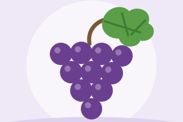

The Cornell Crop and Pest Management Guidelines offer the latest information on topics such as pest management, crop production, and landscape plant maintenance. Each title is updated by Cornell University researchers and Extension specialists and is designed as a practical guide for agricultural and horticultural crop producers, landscape managers, crop consultants and industry advisers, Extension educators, Master Gardeners, or pesticide dealers. Titles currently available include:

<!--
  Guide cards (styled by assets/css/home.css): two columns, filled left to
  right, so keep them in ABC order. Each card is:
    - an image line - an illustration from static/images/guides/ (one per
      guide, e.g. berry-crops.svg; placeholder.svg for a new guide until it
      has one). To use a photo instead, put it in that folder and change the
      file name, keeping the link the same. Any size works: it's shown as a
      thumbnail cropped to fill a 120x80 frame (60x40 on smaller screens), so
      a simple, close-up shot works best.
    - a ### title (linked once the guide is published)
    - an optional one-line description
  Unpublished guides use {.guide-card .coming-soon} and an unlinked title.
-->

::: {.guide-grid}

::: {.guide-card}
[{.guide-card-image}](publications/berry-crops/index.html)

### [Berry Crops](publications/berry-crops/index.html)
:::

::: {.guide-card}
[{.guide-card-image}](publications/field-crops/index.html)

### [Field Crops](publications/field-crops/index.html)
:::

::: {.guide-card}
[{.guide-card-image}](publications/grapes/index.html)

### [Grapes](publications/grapes/index.html)

<!--Comprehensive pest management recommendations for grape growers in New York and Pennsylvania.-->
:::

::: {.guide-card}
[{.guide-card-image}](publications/greenhouse/index.html)

### [Greenhouse Floriculture and Herbaceous Ornamentals](publications/greenhouse/index.html)
:::

::: {.guide-card}
[{.guide-card-image}](publications/hops/index.html)

### [Hops](publications/hops/index.html)
:::

::: {.guide-card}
[{.guide-card-image}](publications/tree-fruit/index.html)

### [Tree Fruit](publications/tree-fruit/index.html)
:::

::: {.guide-card}
[{.guide-card-image}](publications/trees-and-shrubs/index.html)

### [Trees & Shrubs](publications/trees-and-shrubs/index.html)
:::

::: {.guide-card}
[{.guide-card-image}](publications/vegetable-crops/index.html)

### [Vegetable Crops](publications/vegetable-crops/index.html)
:::

:::

## Other Publications

::: {.guide-grid}

::: {.guide-card}
[{.guide-card-image}](publications/organic-vegetable-crops/index.html)

### [Organic Vegetable Crops](publications/organic-vegetable-crops/index.html)
:::

:::

<!--
**Chapters include:**
- Pesticide Information
- Insect & Mite Management  
- Interactive Pesticide Tables

---

### Coming Soon

- **Apple Guidelines** - 2026 Edition
- **Tree Fruit Guidelines** - 2026 Edition
- **Vegetable Guidelines** - 2026 Edition

---
-->

